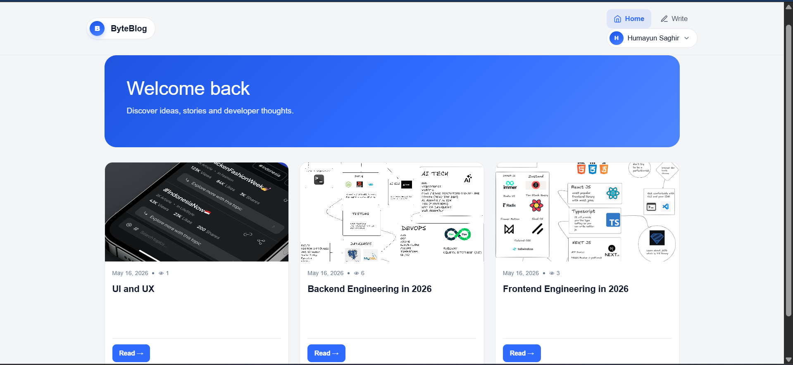
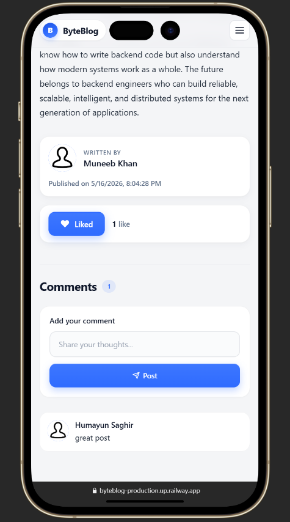

# ByteBlog

A full-stack blogging platform where users can write, publish, and interact with blog posts. Built with Node.js, Express, MongoDB, and EJS.

---

## Screenshots



<p align="center">
  
  
  
</p>

---

## Features

- User authentication with signup and signin (JWT-based, stored in cookies)
- Password hashing using HMAC SHA-256 with salt
- Create and publish blog posts with cover images
- Like and comment on posts
- View count tracking per blog
- User profiles with profile image upload
- Role-based user system (USER / ADMIN)
- Server-side rendering with EJS templates

---

## Tech Stack

- **Runtime:** Node.js
- **Framework:** Express.js
- **Database:** MongoDB + Mongoose
- **Templating:** EJS
- **Authentication:** JSON Web Tokens (JWT) + cookie-parser
- **File Uploads:** Multer
- **Environment Variables:** dotenv

---

## Local Setup

**1. Clone the repository**
```bash
git clone https://github.com/HumayunSaghir/ByteBlog.git
cd ByteBlog
```

**2. Install dependencies**
```bash
npm install
```

**3. Create a `.env` file in the root directory**
```
MONGO_URL=mongodb://127.0.0.1:27017/blogify
secret=your_jwt_secret
```

**4. Start the development server**
```bash
npm run dev
```

The app will be running at `http://localhost:8000`

---

## Deployment

This project is deployed on **AWS EC2** (Ubuntu), with **MongoDB** running on the same instance, **PM2** keeping the Node.js process alive, and **Nginx** as a reverse proxy on port 80.

```
Browser ──► Nginx (:80 / :443) ──► Node.js app via PM2 (:8000) ──► MongoDB (:27017, local only)
```

### 1. Launch the EC2 instance

1. In the AWS Console, go to **EC2** → **Launch instance**
2. **AMI:** Ubuntu Server 24.04 LTS
3. **Instance type:** `t3.small` recommended (`t2.micro` / `t3.micro` works for light use)
4. **Key pair:** create or select one and download the `.pem` file
5. **Security group** inbound rules:

   | Type  | Port | Source   |
   |-------|------|----------|
   | SSH   | 22   | My IP    |
   | HTTP  | 80   | Anywhere |
   | HTTPS | 443  | Anywhere |

6. **Storage:** 20 GB gp3
7. (Optional) Allocate an **Elastic IP** and associate it with the instance so the public IP doesn't change on restart

### 2. Connect to the instance

```bash
chmod 400 your-key.pem
ssh -i your-key.pem ubuntu@<EC2_PUBLIC_IP>
```

### 3. Install Node.js, Git, Nginx and PM2

```bash
sudo apt update && sudo apt upgrade -y
curl -fsSL https://deb.nodesource.com/setup_20.x | sudo -E bash -
sudo apt install -y nodejs git nginx
sudo npm install -g pm2
```

### 4. Install MongoDB

```bash
sudo apt install -y gnupg curl
curl -fsSL https://www.mongodb.org/static/pgp/server-8.0.asc | \
  sudo gpg -o /usr/share/keyrings/mongodb-server-8.0.gpg --dearmor
echo "deb [ arch=amd64,arm64 signed-by=/usr/share/keyrings/mongodb-server-8.0.gpg ] https://repo.mongodb.org/apt/ubuntu noble/mongodb-org/8.0 multiverse" | \
  sudo tee /etc/apt/sources.list.d/mongodb-org-8.0.list
sudo apt update
sudo apt install -y mongodb-org
sudo systemctl enable --now mongod
```

MongoDB listens on `127.0.0.1` only by default, so it is not exposed to the internet. Do **not** open port 27017 in the security group.

### 5. Clone and configure the app

```bash
git clone https://github.com/HumayunSaghir/ByteBlog.git
cd ByteBlog
npm ci --omit=dev
mkdir -p public/uploads public/profileImages
```

Create the `.env` file:

```bash
nano .env
```

```
MONGO_URL=mongodb://127.0.0.1:27017/byteblog
secret=<a long random string>
PORT=8000
```

Tip: generate a strong secret with `openssl rand -hex 32`.

### 6. Start the app with PM2

Run these from inside the `ByteBlog` folder (the app resolves `public/`, `views/` and `.env` relative to the current directory):

```bash
pm2 start app.js --name byteblog
pm2 save
pm2 startup          # run the command it prints, so the app starts on reboot
```

Useful commands: `pm2 status`, `pm2 logs byteblog`, `pm2 restart byteblog`.

### 7. Configure Nginx as a reverse proxy

```bash
sudo nano /etc/nginx/sites-available/byteblog
```

```nginx
server {
    listen 80;
    server_name _;               # or your domain, e.g. byteblog.example.com

    client_max_body_size 10M;    # allow image uploads

    location / {
        proxy_pass http://127.0.0.1:8000;
        proxy_http_version 1.1;
        proxy_set_header Host $host;
        proxy_set_header X-Real-IP $remote_addr;
        proxy_set_header X-Forwarded-For $proxy_add_x_forwarded_for;
        proxy_set_header X-Forwarded-Proto $scheme;
    }
}
```

```bash
sudo ln -s /etc/nginx/sites-available/byteblog /etc/nginx/sites-enabled/
sudo rm /etc/nginx/sites-enabled/default
sudo nginx -t && sudo systemctl reload nginx
```

The app is now live at `http://<EC2_PUBLIC_IP>`.

### 8. (Optional) HTTPS with a domain

Point your domain's **A record** to the instance's Elastic IP, set `server_name` in the Nginx config to your domain, then:

```bash
sudo apt install -y certbot python3-certbot-nginx
sudo certbot --nginx -d your-domain.com
```

### Deploying updates

```bash
cd ~/ByteBlog
git pull
npm ci --omit=dev
pm2 restart byteblog
```

> **Note:** Uploaded images (blog covers, profile pictures) are stored on the instance's disk in `public/uploads/` and `public/profileImages/`. They persist across restarts and redeploys, but are lost if the instance is terminated. For production, consider moving uploads to **AWS S3**.

---

## Project Structure

```
ByteBlog/
├── controllers/       # Route handler logic
├── middlewares/       # Auth check, request logger
├── models/            # Mongoose schemas (users, blogs, comments, likes)
├── public/            # Static assets (CSS, images, uploads)
├── routes/            # Express routers
├── services/          # JWT token utilities
├── views/             # EJS templates
├── app.js             # App entry point
└── connection.js      # MongoDB connection
```

---

## Environment Variables

| Variable    | Description                        |
|-------------|------------------------------------|
| `MONGO_URL` | MongoDB connection string          |
| `secret`    | Secret key used for signing JWTs   |
| `PORT`      | Port the server listens on (default `8000`) |
